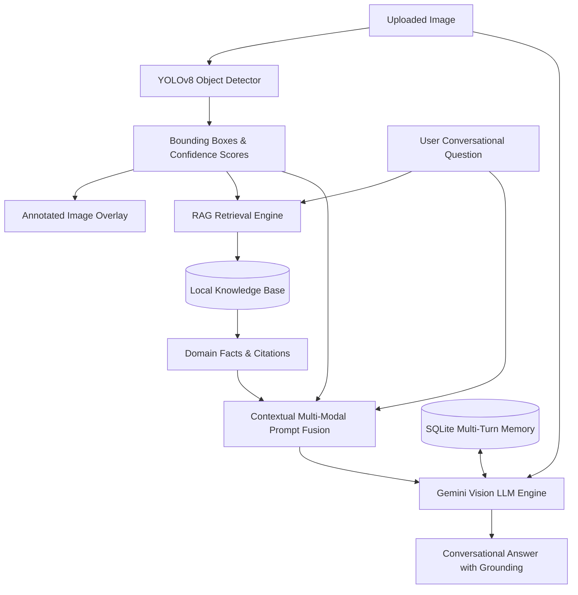

# VisionTalk AI: LLM-Powered Conversational Image Recognition Chatbot

**Smart India Hackathon (SIH1604)**  
VisionTalk AI is a production-grade multi-modal conversational vision chatbot integrating deep learning object detection, vision LLMs, local knowledge retrieval (RAG), persistent conversation memory, and an object detection evaluation suite.

---

## 🌟 Key Features

1. **Multi-Modal Conversational Chatbot**:
   - Ask natural-language questions about uploaded images (`JPG`, `JPEG`, `PNG`).
   - Powered by Google Gemini Vision LLM (`gemini-1.5-flash`, `gemini-1.5-pro`, `gemini-2.0-flash`).
   - Resilient dual-engine architecture: uses Google Generative AI SDK with automatic direct HTTP REST fallback via `requests`.

2. **Real YOLOv8 Object Detection**:
   - Pretrained deep learning detection using YOLOv8 (`yolov8n.pt`).
   - Displays real bounding box coordinates `[x1, y1, x2, y2]`, class names, and confidence scores.
   - Interactive UI controls: confidence threshold filtering, bounding box thickness, label toggling.
   - High-contrast visual overlay rendered with dynamic adaptive labels.
   - Graceful fallback: If YOLO is not installed or loading fails, Gemini vision question answering remains 100% operational with clear diagnostic indicators.

3. **Multi-Turn Conversation Memory**:
   - Persistent conversation sessions backed by an embedded SQLite database (`visiontalk.db`).
   - Supports natural follow-up questions referencing earlier turns and image context.
   - Session manager allows switching between past conversations, clearing chats, and exporting conversation transcripts to JSON.

4. **Retrieval-Augmented Generation (RAG)**:
   - Local vector-indexed domain knowledge base covering vehicle specifications, urban infrastructure standards, ergonomic guidelines, and animal morphology.
   - TF-IDF Cosine Similarity vector retrieval engine with pure-Python token-overlap fallback.
   - Contextually fuses detected object classes and user queries into grounded prompts with citations.
   - Live knowledge search and runtime knowledge addition in the UI.

5. **Detection Performance Evaluation Module**:
   - Evaluates object detection on real annotated benchmark datasets.
   - Calculates mathematical **Intersection over Union (IoU)**, **True Positives (TP)**, **False Positives (FP)**, **False Negatives (FN)**.
   - Computes **Precision**, **Recall**, **F1-Score**, **Average Precision (AP)**, and **mAP@0.5**.
   - Interactive IoU threshold slider and Matplotlib visualizations (Precision-Recall curves and per-class metrics).

6. **Enterprise Resilience & Error Handling**:
   - Gracefully handles missing API keys, network outages, 429 quota exhaustion, and unavailable models.
   - Zero hallucination: does not fabricate bounding boxes or evaluation metrics.

---

## 🏛️ System Architecture



---

## 📂 Project Structure

```
VisionTalk_AI/
├── app.py                      # Main Streamlit web application
├── requirements.txt            # Python dependencies
├── .env.example                # Example environment configuration
├── .gitignore                  # Git ignore rules
├── README.md                   # Complete system documentation
├── visiontalk.db               # SQLite database (auto-created on first run)
├── modules/
│   ├── __init__.py             # Package init
│   ├── database.py             # SQLite multi-turn chat & session manager
│   ├── detector.py             # YOLOv8 object detection & PIL visual annotation
│   ├── llm_client.py           # Gemini Vision client (dual SDK + REST fallback)
│   ├── rag_engine.py           # TF-IDF Cosine Similarity RAG knowledge engine
│   └── evaluator.py            # Precision, Recall, F1, and mAP evaluation engine
├── knowledge_base/
│   └── objects_knowledge.json  # Structured domain knowledge base for RAG
├── sample_data/
│   ├── annotations.json        # Ground-truth annotations for evaluation benchmark
│   ├── generate_samples.py     # Script to generate test benchmark images
│   ├── scene_traffic_01.jpg    # Sample traffic benchmark image
│   ├── scene_workspace_02.jpg  # Sample workspace benchmark image
│   └── scene_park_03.jpg       # Sample park benchmark image
└── tests/
    ├── __init__.py             # Test package init
    ├── test_database.py        # SQLite persistence unit tests
    ├── test_detector.py        # Detection & annotation unit tests
    ├── test_evaluator.py       # IoU, Precision, Recall, F1, mAP unit tests
    ├── test_llm_client.py      # Gemini Vision client unit tests
    └── test_rag.py             # RAG search & indexing unit tests
```

---

## 🚀 Quickstart Guide

### 1. Prerequisites
- Python 3.10+ (Tested on Python 3.13)
- Google Gemini API Key ([Get a free key at Google AI Studio](https://aistudio.google.com/))

### 2. Environment Setup
```powershell
# Clone or navigate into the project directory
cd "VisionTalk_AI"

# Optional: Create and activate a virtual environment
python -m venv venv
.\venv\Scripts\Activate.ps1

# Install dependencies
pip install -r requirements.txt
```

### 3. Configure API Credentials
Create a `.env` file from `.env.example`:
```powershell
Copy-Item .env.example .env
```
Open `.env` and set your key:
```env
GEMINI_API_KEY=AIzaSy...your_gemini_key_here
```
*(Alternatively, you can enter your API key directly in the web UI sidebar at runtime!)*

### 4. Run the Application
Execute the following PowerShell command:
```powershell
streamlit run app.py
```
Open your browser at `http://localhost:8501`.

---

## 🧪 Automated Testing

VisionTalk AI comes with a comprehensive test suite covering the database, RAG engine, evaluation calculations, detector, and LLM client:

```powershell
# Run with Python standard library unittest
python -m unittest discover -s tests -v

# Or run with pytest
pytest tests/ -v
```

All 18 automated tests verify:
- SQLite session creation, message storage, multi-turn retrieval, and history clearing.
- TF-IDF Cosine Similarity knowledge ranking and keyword fallback.
- Exact mathematical IoU calculation (identical, disjoint, and fractional overlaps).
- False Positive (FP), False Negative (FN), Precision, Recall, and mAP@0.5 calculation.
- Error handling for missing API keys and graceful fallback modes.

---

## 📊 Evaluation Module (SIH1604)

The evaluation tab runs an automated benchmark comparing detections against ground-truth boxes in `sample_data/annotations.json`:

$$\text{IoU} = \frac{\text{Area of Overlap}}{\text{Area of Union}}$$

$$\text{Precision} = \frac{\text{TP}}{\text{TP} + \text{FP}}, \quad \text{Recall} = \frac{\text{TP}}{\text{TP} + \text{FN}}, \quad F_1 = 2 \cdot \frac{\text{Precision} \cdot \text{Recall}}{\text{Precision} + \text{Recall}}$$

$$\text{mAP@0.5} = \frac{1}{|C|} \sum_{c \in C} \text{AP}_c$$

Interactive controls allow adjusting the IoU threshold (0.30 to 0.90) to visualize how precision, recall, and Average Precision curves respond in real time.
